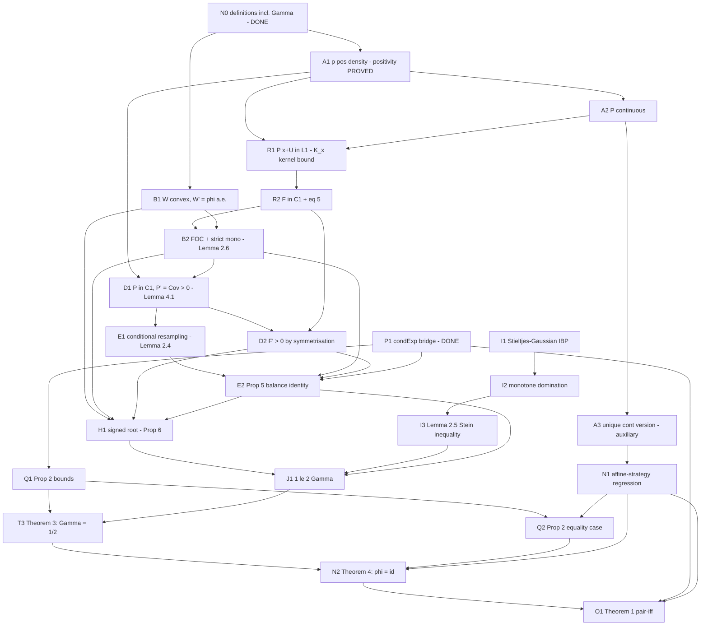

# Proof blueprint — Monteiro–Tourky, "The one-period Gaussian Kyle model has exactly one equilibrium"

> ## ⬛ CAMPAIGN COMPLETE — 2026-09-16 (working tree, uncommitted on top of
> commit `f975dbc`; figures below do not hold at that commit — re-pin the hash
> once the closeout is committed)
>
> **Every node on this DAG is closed.** Session 1 (2026-08-12) and Session 2
> (2026-08-18) cleared the early tiers and the Stein pipeline; Session 3
> (2026-09-16) ran Waves 1–3 and finished the campaign. From-scratch
> `lake build`: green, 3149 jobs, **0 `sorry`**, every audited declaration
> `[propext, Classical.choice, Quot.sound]`. 19 files, 10,120 LOC.
>
> **This document is v3-keyed and is kept as the historical proof plan.** The
> artifact is keyed to arXiv:2607.23585 **v4**; the crosswalk is
> `../STATEMENT_NOTES.md` §1 and `../V4_DELTA_REPORT_2026-09-16.md` §1, and the
> binding route decisions taken at the v4 re-baseline are
> `LANE_C_DECISIONS_2026-09-16.md` (D1–D9). Where a node name below says
> "Lemma 2.5" or "Proposition 6", read the crosswalk first.

### Node census — every node, its file, and where it was closed

| Node | Content (v3 name → v4 name) | File | Closed |
|---|---|---|---|
| N0 | model, pair predicate, `Γ`, `stdModel` | `Definitions.lean` | statement phase |
| P1 | Bayes quotient ↔ `condExp` bridge | `CondExpBridge.lean` | canary phase |
| A1 | `p` everywhere-positive density (Lemma 2.1) | `Statement.lean` | canary phase / Session 1 |
| A1b | joint density of `(V,Y)` (Lemma 2.1) | `Posterior.lean` | Session 3, Wave 1 |
| A2 | `P` continuous (Lemma 2.2) | `Statement.lean` | Session 1 |
| A3 | uniqueness of the continuous version (auxiliary) | `Statement.lean` | Session 1 |
| R1 | `P(x+U) ∈ L¹` (Lemma 2.3) | `Statement.lean` | Session 1 |
| R2 | `F ∈ C¹`, eq. (5) → **(2.3)** | `Regularity.lean` | Session 2 |
| R2b | tower clause `F(φ(V)) = E[E[V∣Y]∣V]` (Lemma 2.3) | `Resampling.lean` | Session 3, Wave 1 |
| B1 | value function: real-valued, convex, `W′ = φ` a.e. | `ValueFunction.lean` | Session 3, Wave 1 |
| B2 | FOC + strict monotonicity (Lemma 2.6 → **2.4**) | `ValueFunction.lean` | Session 3, Wave 1 |
| D1 | `P ∈ C¹`, `P′ = Cov_{π_y} > 0` (Lemma 4.1 → **2.5**) | `PosteriorDeriv.lean` (C¹ legs) + `Posterior.lean` | Session 2 + Wave 1 |
| D2 | `F′ > 0` by symmetrisation | `Posterior.lean` | Session 3, Wave 1 |
| E1 | conditional resampling (Lemma 2.4 → **2.6**) | `Resampling.lean` | Session 3, Wave 1 |
| — | `Γ = E[F′(φ(V))]`, definiens agreement (**Lemmas 3.1/3.2**, new in v4) | `Loss.lean` | Session 3, Wave 1 |
| E2 | balance/accounting identity (Prop 5 → **Prop 5.1**) — *hard block 3* | `Accounting.lean` | Session 3, Wave 2 |
| H1 | signed root (Prop 6 → unnumbered inside **Prop 6.1**) — *hard block 4b* | `SignedRoot.lean` | Session 3, Wave 2 |
| I1–I3 | one-sided Gaussian/Stein inequality (v3 Lemma 2.5) — *hard block 2* | `SteinInequality.lean` | Session 2 |
| J1 | `1 ≤ 2Γ` | `SignedRoot.lean` | Session 3, Wave 2 |
| Q1 | `\|Γ\| ≤ 1/2` (Prop 2 → **Prop 4.1**) | `Statement.lean` | Session 1 |
| Q2 | equality case `φ = ±v + a` a.e. | `Statement.lean` | Session 1 |
| N1 | affine-strategy inverse regression | `Statement.lean` | Session 1 |
| T3 | `Γ = 1/2` (Thm 3 → **Prop 6.1**) | `Main.lean` | Session 3, Wave 3 |
| N2 | rigidity `φ = id` (Thm 4 → **Thm 7.1**) | `Main.lean` | Session 3, Wave 3 |
| O1 | **Theorem 1 → 1.1**, location–scale + pair form | `Main.lean` | Session 3, Wave 3 |
| M1 | cubic / `β_γ` layer (v2 only, off-DAG) | `BeyondPaper.lean` | v2 phase, fenced |
| R3 | *optional*: a.e.-maximisation variant (v3 Lemma 2.7 → v4 **Appendix B**) | — | **NOT DONE** — deviation F11 |

Hard-block census: **0 of 5 remain.** The twelve deviations from the paper's
v4 text (F1–F12) are in `../STATEMENT_NOTES.md` §5; the one open completeness
item is a general-parameter `KyleModel` inhabitant.


**Source:** arXiv:2607.23585 **v3** (2026-08-10), fetched and diffed against v2
in full on 2026-08-12 (`../V3_RECONCILIATION_PLAN.md` — the authoritative
v2 → v3 delta; this blueprint is the post-reconciliation revision). All
section / equation numbers below are **v3's**. Companion documents:
`mathlib_api_audit.md` (API surface verified against the pin
`mathlib @ 81a5d257` = tag v4.32.0; see its §12 addendum for the canary-phase
corrections), `attack_order.md`.

**Status: LOCAL ONLY. Nothing here is public. No pushes, no Zulip, no announcements.**

**Canary-phase state (2026-08-12):** node **P1 is DONE** (the pricing-rule
bridge `CondExpBridge.lean`, ~500 LOC, proved), `GaussianHelpers.lean` is done
(Tier 0.1), the two canaries (`kyleStrategy_isEquilibrium`,
`lemma21_isPricingRule`) and A1's positivity leg are proved, and the
identity-theorem spike (Tier 0.4) succeeded — though v3 deleted its consumer.
14 sorries remain in `Statement.lean`; this blueprint decomposes them.

---

## 0. What v3 changed (executive summary for this file)

v3 rewrote the proof architecture: **no complex analysis anywhere** ("The
proof is probabilistic and convex-analytic and uses no complex analysis"),
the γ-penalty family deleted, and the proof reorganised around
**Γ := Cov(U, E[V∣Y])**, the noise traders' expected loss (eq. (13)).
Consequences for the DAG:

- **Deleted nodes (9):** A4 (growth bound), A5 (entire/real-analytic F),
  C (Prop 2.4 statement), F1 (Gaussian IBP), F2 (channel identities),
  G1 (AB ≤ 1 pincer upper jaw), K1 (Prop 2.4 assembly), L1, L2 (Euler
  identity + identity-theorem endgame). Three of the five v2 hard blocks
  (HB1 = A4+A5, HB4a = G1, HB5 = L1+L2) died with them.
- **New nodes (4 + 1 optional):** R1, R2 (v3 Lemma 2.3's integrability and
  C¹ smoothing — the standard-grade replacements for A4/A5), Q1, Q2 (v3
  Proposition 2 — the covariance bound and its rigidity equality case, the
  replacement for G1 *and* L1/L2), R3 (optional: Lemma 2.7, the
  a.e.-maximisation variant — deferred).
- **Changed nodes (7):** N0 (Γ instead of A/B/e/R), D2 (F′ > 0 by
  symmetrisation — no IBP), E1 (Lemma 2.4 conditional resampling), E2
  (Prop 5 — chain reduced), J1 (1 ≤ 2Γ), N2 (promoted to Theorem 4), O1
  (strengthened to the pair-iff Theorem 1). New tiny assembly node T3
  (Theorem 3: Γ = 1/2).
- **Unchanged nodes (9):** A1, A2, B1, B2, D1, I1, I2, I3, H1 (paper refs
  renumbered; content identical).
- **Orphaned:** M1 (cubic/β_γ — already proved; moved to
  `KyleUniqueness/BeyondPaper.lean`, off the DAG), M2 (γ-classification —
  dissolved into N2), A3 (demoted to auxiliary — v3 phrases uniqueness
  a.e./a.s., the continuous-version statement survives as a corollary
  feed).

## 0′. Conventions

- **Normalised model throughout** (paper §2): `V, U : Ω → ℝ` independent
  standard normal. In Lean we work distributionally: `γ𝕘 := gaussianReal 0 1`,
  `ϱ := gaussianPDFReal 0 1` (`stdNormalPDF`), and a fixed Borel `φ : ℝ → ℝ`
  (`hφ : Measurable φ`). Theorem 1's general model enters only at node **O1**
  via location–scale.
- **Joint law, not abstract probability space.** Everything in §§2–4 is a
  statement about explicit measures on ℝ, ℝ² and ℝ³ built with
  `Measure.compProd` / `withDensity`. Abstract `condExp` appears in exactly
  two places: the faithfulness bridge (node **P1 — DONE**) and the
  L²-contraction step of Q1.
- Namespace `KyleUniqueness`, files per the module plan in §4 below.
- Difficulty grades: **mechanical** (≤ a session with the stated APIs),
  **standard** (real proof work, known Mathlib route, 1–4 sessions),
  **hard-block** (delicate mathematics or missing Mathlib infrastructure;
  human+AI co-work).

### Central objects (Lean-facing definitions, node N0 — largely DONE)

| Paper object | Definition | Paper ref | Status |
|---|---|---|---|
| `Y = φ(V) + U` | `KyleModel.orderFlow` on `stdModel`; law-level via `flowPDF` | §1–2 | done |
| `p y = E[ϱ(y − φ V)]` | `flowDensity` (= `stdModel.flowPDF`) | §2.2, Lemma 2.1 | done; positivity proved |
| `P y` | `inverseRegression` = `n y / p y` (the explicit Bayes quotient **by which v3 §2.2 defines P**; eq. (6)) | §2.2 | done; is-pricing-rule proved (canary) |
| `F x = E[P (x + U)]` | `gaussianSmoothing` | eqs. (3)–(4) | done |
| **`Γ = Cov(U, E[V∣Y])`** | `noiseTraderLoss` = `E[U·P(Y)]` on the canonical space | eq. (13) | done (def) |
| `W v = ⨆ x, x(v − F x)` | to define in `ValueFunction.lean` (attainment form; finiteness = B1) | eq. (8) | proof phase |
| condition (17) | `IsGammaSolution 0` | eq. (17) | done |
| `π_y` posterior | `volume.withDensity (fun v ↦ ϱ v · ϱ(y − φ v) / p y)` | §2.2 | proof phase |
| `μJoint`, resampling triple | `withDensity` on ℝ² / ℝ³ | Lemma 2.4 | proof phase (E1) |
| equilibrium pair | `KyleModel.IsEquilibrium` | §1 | done |

> Design note (unchanged, now vindicated): defining `P := n/p` *pointwise*
> (total, no a.e. garbage) keeps every analytic lemma condExp-free; v3
> §2.2 adopts exactly this definition, and the bridge to `condExp` is the
> **proved** canary `lemma21_isPricingRule`.

---

## 1. Lemma DAG

Legend: each node lists (a) informal statement, (b) v3 reference, (c) proof
sketch, (d) Mathlib APIs (verified against the pin — `mathlib_api_audit.md`),
(e) difficulty, (f) depends on.



---

### Node N0 — Model definitions — **DONE**

Delivered in `Definitions.lean` + `CondExpBridge.lean` during the statement
and canary phases: the model, the pair predicate, `flowDensity` /
`inverseRegression` / `gaussianSmoothing` / `noiseTraderLoss`, `objective` /
`IsGammaSolution`, `stdModel` (proved inhabited). Remaining N0-grade work is
the proof-phase-internal objects (`W` in attainment form, `π_y`, the
resampling measures) — defined in their consuming files, not in the claim
surface. v2's `A, B, e, R` definitions are **gone** (v3 needs only Γ).

### Node A1 — `p` is an everywhere-positive density of Y  (Lemma 2.1)

- **(a)** `p` is continuous, strictly positive (**proved**:
  `lemma21_flowDensity_pos`), and the law of `Y` equals
  `volume.withDensity (ofReal ∘ p)`; joint density of `(V, Y)` as stated in
  v3 Lemma 2.1.
- **(b)** Lemma 2.1; §2.2.
- **(c)** Positivity: integrand `ϱ(v)ϱ(y−φv) > 0`, support has full measure
  (done). Marginal: Tonelli on the compProd (the `flowPDF` machinery in
  `CondExpBridge.lean` already carries the density identity along the flow).
  Continuity of `p`: dominated convergence with dominant `‖ϱ‖∞ · ϱ(v)`.
- **(d)** `tendsto_integral_of_dominated_convergence`,
  `integral_pos_iff_support_of_nonneg_ae` (used), `withDensity` API.
- **(e)** mechanical (positivity done; the rest small).
- **(f)** N0.

### Node A2 — `P = n/p` is continuous  (Lemma 2.2, continuity clause)

- **(a)** `n, p` finite and continuous; `P := n/p` continuous
  (= `lemma21_continuous`).
- **(b)** Lemma 2.2 (v3 proves continuity in App. A / via Lemma 4.1's C¹).
- **(c)** Finiteness: domination `y·φv − φv²/2 ≤ y²/2` (complete the
  square); dominated convergence for continuity, locally uniform dominant.
- **(d)** `Integrable.mono'`, `integrable_exp_neg_mul_sq`-adjacent, DCT as
  in A1.
- **(e)** mechanical.
- **(f)** N0.

### Node A3 — Uniqueness of the continuous version — **auxiliary (demoted)**

- **(a)** If `Q` is continuous and `Q = P` Lebesgue-a.e., then `Q = P`
  everywhere; with A1, `Law(Y)`-a.e. ⇒ Lebesgue-a.e.
  (= `lemma21_unique_continuous_version`; consumed by
  `eq_kylePricingRule_of_continuous` — itself already derived from the
  a.e.-primary statement — and by N1's uniqueness route.)
- **(b)** v3 phrases uniqueness a.e./a.s. only; this node is v2 legacy kept
  as an auxiliary. NOT claim surface.
- **(c)** `{Q ≠ P}` is open (continuity) and Lebesgue-null ⇒ empty
  (`IsOpen.measure_pos`); a.e.-equivalence Lebesgue ↔ `Law(Y)` from `p > 0`.
- **(d)** `IsOpen.measure_pos`, `Continuous.ae_eq_iff_eq` (pin-verified;
  already used in `Statement.lean`), withDensity null-set transfer.
- **(e)** mechanical.
- **(f)** A1, A2.

### Node R1 — `P(x+U) ∈ L¹` via the `K_x` kernel bound  (Lemma 2.3, integrability) — **NEW (replaces A4)**

- **(a)** For every Borel `φ` and every `x`:
  `Integrable (fun y => P y * ϱ(y − x)) volume` (= `lemma23_integrable`);
  equivalently `P(x+U) ∈ L¹` for the canonical version (general versions by
  a.e. agreement — `expectedProfit_congr_ae` machinery, proved).
- **(b)** Lemma 2.3, App. A (the `K_x` argument).
- **(c)** v3's route: `E[|P(x+U)|] ≤ E[|V|·K_x(φ(V))]` with
  `K_x(a) = ∫ ϱ(y−x)ϱ(y−a)/p_Y(y) dy`, bounded μ-a.e. via the
  complete-the-square identity `∫ ϱ(y−x)ϱ(y−a)/ϱ(y−d) dy = e^{(x−d)(a−d)}`
  and a positive-mass interval `[α, β]` for `Law(φ(V))` — the three cases
  (`μ((x,∞)) > 0` / `μ((−∞,x)) > 0` / `μ = δ_x`) are short and symmetric.
  **No WLOG flip, no sign-structure trichotomy** (that was v2's A4, the old
  hard-block ingredient — deleted).
- **(d)** complete-the-square via `gaussianPDFReal` algebra
  (`GaussianHelpers` has the Kyle-shaped instance), `Integrable.mono'`,
  `exists_pos_measure_of...`-style positive-mass interval extraction
  (`MeasureTheory.measure_iUnion_null_iff` contrapositive), Tonelli.
- **(e)** standard (~250–400 LOC).
- **(f)** A1, A2.

### Node R2 — `F ∈ C¹` + eq. (5)  (Lemma 2.3, regularity) — **NEW (replaces A5)**

- **(a)** `F` is continuously differentiable with
  `F′(x) = ∫ P(y)(y−x)ϱ(y−x) dy = ∫ u·P(x+u)ϱ(u) du` (eq. (5), both
  forms); `F(φ(V)) = E[E[V∣Y]∣V]` a.s. (Lemma 2.3's bookkeeping clause,
  consumed by E2).
- **(b)** Lemma 2.3, App. A.
- **(c)** Differentiation under the integral over ℝ with the shift
  domination `(1+|y|)e^{R|y|} ≤ C(e^{Ay} + e^{−Ay})`, majorant integrable
  by R1 applied at `x = ±A`.
  `hasDerivAt_integral_of_dominated_loc_of_deriv_le` with **𝕜 = ℝ** — no
  complex analysis, no Cauchy–Goursat, no restriction–analyticity glue
  (v2's A5, HARD BLOCK 1, is gone from the mathematics).
- **(d)** `hasDerivAt_integral_of_dominated_loc_of_deriv_le`
  (ParametricIntegral.lean, `[RCLike 𝕜]` — instantiate at ℝ),
  `hasDerivAt_gaussianPDFReal` (proved, `GaussianHelpers`),
  `continuous_integral_of_dominated`-style for `F′` continuity.
- **(e)** standard (~300–450 LOC).
- **(f)** R1.

### Node B1 — Value function: convex, finite, `W′ = φ` a.e.  (§2.3, eq. (8), (11))

Unchanged from the v2 blueprint (v3 packages it inside Lemma 2.6; the
subgradient inequality is (29) in App. A). Statement, proof sketch, APIs,
difficulty **standard**, and the corollary `W_eq_integral_phi` all carry
over verbatim — only the paper refs renumber (v2 §2.1/eq. (6) → v3
Lemma 2.6/eq. (11)). Route choice unchanged: attainment form, direct
convexity from affine-in-`v` objectives, a.e. differentiability via
`Monotone.countable_not_continuousAt` (no Rademacher).

- **(f)** N0 (+ R2 only for stating `F` inside the objective).

### Node B2 — FOC and strict monotonicity  (Lemma 2.6, eqs. (9)–(12))

Unchanged from the v2 blueprint at `γ = 0` (v2's Lemma 2.3 with the γ terms
dropped): FOC `F(φv) + φ(v)F′(φv) = v` for every `v` (eq. (9)), `W = φ²F′(φ)`
(eq. (10)), strict monotonicity and `φ(v) → ±∞` (eq. (12)). Proof sketch and
APIs as before (`IsLocalMax.deriv_eq_zero` route, injectivity from FOC,
`Monotone.tendsto_atTop_atTop`). Difficulty **standard**.

- **(f)** R2, B1.

### Node D1 — Posterior differentiation: `P ∈ C¹`, `P′ = Cov_{π_y} > 0`  (Lemma 4.1, eq. (20))

Unchanged from the v2 blueprint (v2 Lemma 4.2 → v3 Lemma 4.1; eqs. (10)–(12)
→ (20)): differentiation under the integral for `n, p`; quotient rule;
`P′(y) = Cov_{π_y}(id, φ) = ½∬(v−w)(φv−φw) dπ_y dπ_y > 0` via the
symmetrised form, positivity off the null diagonal
(`measure_prod_diagonal_eq_zero` — **proved** in `GaussianHelpers`).
Difficulty **standard**.

- **(f)** A1, A2, B2.

### Node D2 — `F′ > 0` by symmetrisation  (Lemma 4.1, eq. (21)) — **simplified**

- **(a)** `F′(x) > 0` for every `x`.
- **(b)** Lemma 4.1 (21).
- **(c)** **v3's new route — no interval IBP, no boundary-term analysis:**
  with two independent standard Gaussians `U₀, U₁`,
  `E[(U₀ − U₁)(P(x+U₀) − P(x+U₁))] = 2F′(x)` (expand via eq. (5)'s
  `F′(x) = ∫ u P(x+u)ϱ(u) du`); the left side is an integral of a strictly
  positive function off the diagonal (P strictly increasing by D1). The v2
  formula `F′ = ∫P′ϱ` is **no longer needed at all**.
- **(d)** Fubini on `γ𝕘 ⊗ γ𝕘`, D1's strict monotonicity of `P`,
  `measure_prod_diagonal_eq_zero` (proved), R2's eq. (5).
- **(e)** standard (shorter than v2's D2).
- **(f)** D1, R2.

### Node P1 — condExp bridge — **DONE (canary phase)**

Delivered as `CondExpBridge.lean`: the strategy-generic pricing-rule bridge
`isPricingRule_of_forall_mul_flowPDF` (density identity ⇒ pricing rule, via
`ae_eq_condExp_of_forall_setIntegral_eq`, indicator test functions,
product-space transfer, inner-noise translation, one Fubini swap), the
master identity `integral_mul_orderFlow_eq` (test-function form
`E[g(Y)Q(Y)] = E[g(Y)V]` for bounded `g`), and the affine consumers.
What remains P1-adjacent for Q1: the `g = P` (L²) extension of the master
identity — `E[V·P(Y)] = E[P(Y)²]` — and the L²-contraction
`E[P(Y)²] ≤ E[V²] = 1` (= `lemma22_memLp_two` + conditional Jensen or the
direct Cauchy–Schwarz route). Rate that residue **standard**, small.

### Node E1 — Conditional resampling  (Lemma 2.4) — **restructured**

- **(a)** The extension `Ω̃ = Ω × ℝ` / explicit-ℝ³-measure carrying `(V₀,
  V₁, Y)` with `V₁` resampled from the posterior; parts (i)–(iv) of v3
  Lemma 2.4 — exchangeability, marginals, and (iv)
  `E[V₁∣V₀] = F(φ(V₀))` (v2's eq. (14), absorbed).
- **(b)** Lemma 2.4.
- **(c)** As in the v2 plan: one flat `withDensity` on ℝ³ with density
  `πdens y v₀ · πdens y v₁ · p y`; all four parts by Tonelli/Fubini on the
  explicit density; (iv) in test-function form
  `∫ v₁ g(v₀) dμ₃ = ∫ F(φ v₀) g(v₀) dγ𝕘` for bounded measurable `g` —
  avoids `condExp` entirely.
- **(d)** `Measure.compProd`/`withDensity`, Tonelli,
  `integral_gaussianPDFReal_eq_one`, R1 for integrability of the F-leg.
- **(e)** standard (structure); the pair carries the hard content in E2.
- **(f)** A1, D1.

### Node E2 — Proposition 5: the balance identity — **HARD BLOCK 3, reduced**

- **(a)** `Γ = E[F′(φ(V))] = E[W(V)] > 0` (eq. (22)); en route the replica
  identity (23) and the truncation chain (24) with `aₙ`.
- **(b)** Proposition 5 (§4.3).
- **(c)** The v2 five-link chain loses two legs: the `E[P′(Y)]` identity
  (v2 (15)) and one MCT pass are **gone**. Remaining:
  `Γ = E[U·P(Y)]` (unnumbered display; from P1's master identity),
  replica identity (23) via E1(iv), truncation `aₙ x = max (−n) (min x n)`
  chain (24) with exchangeability + FOC, monotone limits (`lintegral_iSup`
  in ℝ≥0∞, transfer to Bochner on the finite legs).
- **(d)** `lintegral_iSup`, `integral_tendsto_of_tendsto_of_monotone`,
  Fubini/Tonelli as in E1, the case-bash `|aₙ a − aₙ b| ≤ |a − b|`
  treatment of the truncation, FOC from B2.
- **(e)** **hard-block by volume** (~400–600 LOC, down from 500–700): the
  MCT-with-∞ bookkeeping and the test-function form of (iv) remain the
  effort concentration.
- **(f)** B2 (FOC), D1, D2, E1, P1.

### Node H1 — Signed root of the value function  (Proposition 6) — **HARD BLOCK 4b, unchanged**

Unchanged from the v2 blueprint (v2 Lemma 5.2 → v3 Prop 6; eqs. (27)–(30) →
(25)–(28); `E[h²] = A, E[1/h′²] = B` becomes **`E[h(V)²] = 2Γ` and
`E[1/h′(V)²] = 2Γ`** (28) — cosmetic renaming of the targets). The
construction — `c = sup{φ < 0}` (25), `h` piecewise `±√(2W)` (26),
`h′ = 1/√(2F′(φ))` a.e. (27), the `|φ|` cancellation, the a.e./chain-rule
bookkeeping at the null point `c` — is exactly as planned. Difficulty
**hard-block** (~400–600 LOC): human-designed skeleton, agents fill leaves.

- **(f)** B1, B2, D2, E2 (for `Γ` finite via (22)).

### Nodes I1, I2, I3 — the Stein pipeline  (Lemma 2.5, eq. (7)) — **HARD BLOCK 2, unchanged, de-fanged**

Unchanged from the v2 blueprint (v2 Lemma 5.3 → v3 Lemma 2.5; eq. (31) →
eq. (7); v3's *statement* keeps only the outer inequality
`1 ≤ √(E[f²]·E[1/f′²])`, the middle terms `1 ≤ E[f′]E[1/f′]` living in the
App.-A proof — formalize the chain, expose the outer form):

- **I1** — Stieltjes–Gaussian IBP for monotone bounded `f`:
  `∫ ϱ dμ_f = E[Z f(Z)]` by the layer-cake/Tonelli route (no BV library).
- **I2** — monotone-Stieltjes domination `∫ g·f′ ≤ ∫ g dμ_f` via the audit's
  three pin-present lemmas (`Monotone.ae_hasDerivAt` — the a.e. derivative
  IS `rnDeriv μ_f volume`; `withDensity_rnDeriv_le`;
  `lintegral_withDensity_eq_lintegral_mul`), plus truncation compatibility.
- **I3** — assembly with the finiteness-ordering care; three Cauchy–Schwarz
  applications.

Zero project imports; **the premier Mathlib-upstream candidate**. Difficulty
standard (post-audit downgrade), ~600–950 LOC total.

- **(f)** — (independent; shares the Gaussian tail FTC with
  `GaussianHelpers`, already proved).

### Node J1 — Lower jaw: `1 ≤ 2Γ` under condition (17) — **simplified**

- **(a)** If `φ` satisfies (17) then `2Γ ≥ 1` (the §4.4 completion:
  `1 ≤ √(E[h²]·E[1/h′²]) = √(2Γ·2Γ) = 2Γ`).
- **(b)** §4.4 (proof of Theorem 3).
- **(c)** Apply I3 with `Z = V`, `f = h` (H1); hypotheses from H1's
  (27)–(28) + E2's finiteness of Γ. One Stein application; **no √(AB)
  algebra** (v2's A·B bookkeeping is gone).
- **(d)** trivial glue over H1 + I3.
- **(e)** mechanical.
- **(f)** H1, I3, E2.

### Node Q1 — Proposition 2, the bounds  (eqs. (13)–(14)) — **NEW (replaces G1's upper jaw)**

- **(a)** For EVERY Borel `φ`: `Γ` is finite (`integrable_noiseTraderLoss`)
  and `|Γ| ≤ 1/2` (`noiseTraderLoss_le_half`); plus the moment dictionary
  entries it needs: `P(Y) ∈ L²` (`lemma22_memLp_two`), the projection
  identity `E[V·P(Y)] = E[P(Y)²]`, `E[P(Y)²] ≤ 1`.
- **(b)** Proposition 2, first half (§3; proof in §5.1 of the numbering of
  v3's layout — the elementary L² argument).
- **(c)** Entirely elementary: with `M = P(Y)`, `X = 2M − V`, `s = ±1`:
  `0 ≤ E[(X − sU)²] = E[X²] − 2sE[XU] + 1`; `E[X²] = 4E[M²] − 4E[VM] +
  E[V²] = 1` (projection identity + conditional Jensen `E[M²] ≤ E[V²] = 1`);
  `E[XU] = 2E[MU] = 2Γ` (independence kills `E[VU]`); rearrange ⇒
  `|Γ| ≤ 1/2`. The projection identity and contraction come from P1's
  master identity extended to `g = P` (L² test functions) — the only
  non-one-line ingredient.
- **(d)** P1 (done) + `MemLp.integrable_mul`, Cauchy–Schwarz
  (`integral_mul_le_Lp_mul_Lq_of_nonneg`), `memLp_id_gaussianReal`,
  `nlinarith` for the final algebra.
- **(e)** mechanical–standard (~100–200 LOC). All APIs at the pin.
- **(f)** P1, A1/A2 (for `P` basics); feeds T3, Q2.

### Node Q2 — Proposition 2, the equality case  (eqs. (15)–(16)) — **NEW (replaces G1's equality case AND L1/L2)**

- **(a)** `Γ = s/2` (`s = ±1`) iff `φ(v) = sv + a` for Lebesgue-a.e. `v`,
  some `a` (`noiseTraderLoss_eq_half_iff`, `noiseTraderLoss_eq_neg_half_iff`).
- **(b)** Proposition 2, second half.
- **(c)** (⇒) Equality in Q1's chain forces `E[(X − sU)²] = 0`, i.e.
  `2P(Y) = V + sU` a.s. (eq. (16)). Push to the joint density:
  `y − 2sP(y) = φ(v) − sv` for `μJoint`-a.e. `(v, y)` ⇒ Tonelli sections of
  the complement null set (`Measure.ae_ae_of_ae_compProd`) ⇒ for a.e. `v`,
  the section identity holds Lebesgue-a.e. in `y`; **translation invariance
  of Lebesgue measure** (`measure_preimage_add`, in Mathlib) aligns the
  sections across two generic values `v₀, v₁` ⇒ `φ(v) − sv` is a.e.
  constant. (⇐) affine `φ` ⇒ `(V, Y)` jointly Gaussian ⇒ `P` affine by
  N1 ⇒ compute `Γ = s/2` directly.
- **(d)** `Measure.ae_ae_of_ae_compProd` / `Measure.measure_prod_null`,
  `measure_preimage_add` (Lebesgue translation invariance),
  `integral_eq_zero_iff_of_nonneg` on `(X − sU)²`, N1's computation.
- **(e)** standard (~200–350 LOC). **This is the node that replaced v2's
  hard blocks 4a AND 5** — genuinely new formal content, but every
  ingredient is core Mathlib measure theory.
- **(f)** Q1, N1.

### Node T3 — Theorem 3 assembly: `(17) ⇒ Γ = 1/2`  (eqs. (17)–(18))

- **(a)** Any `φ` satisfying the pointwise-maximisation condition (17) has
  `Γ = 1/2`.
- **(b)** Theorem 3 (all of §4 assembles here).
- **(c)** `2Γ ≥ 1` (J1) + `Γ ≤ 1/2` (Q1) ⇒ `Γ = 1/2`. Trivial glue.
- **(e)** mechanical. **(f)** J1, Q1.

### Node N1 — Inverse regression of an affine strategy  (Thm 4 / Thm 1 proofs)

- **(a)** `inverseRegression (fun v => v + a) = fun y => (y − a)/2` and
  `gaussianSmoothing (fun v => v + a) = fun x => (x − a)/2`
  (= `inverseRegression_affine`, `gaussianSmoothing_affine`; the `id`
  instances are already derived from these). General slope `β > 0` no
  longer needed (the γ-family is gone) — **unit slope with intercept
  only**, which is all Theorem 4's proof uses.
- **(b)** Proof of Theorem 4 ("(V, Y) jointly Gaussian ⇒ regression
  formula") and of Theorem 1 (§3.1).
- **(c)** Direct route via the explicit Bayes quotient: complete the square
  `ϱ(v)ϱ(y−v−a) = ϱ_{√2}(y−a) · ϱ_{mean (y−a)/2, var 1/2}(v)`, then
  `n/p = (y−a)/2` by `integral_id_mul_gaussianPDFReal` (proved,
  `GaussianHelpers` — the Kyle-shaped complete-the-square
  `gaussianPDFReal_mul_gaussianPDFReal_kyle` at `σ = τ = 1` is exactly this
  factorization up to the shift). `F` then by translation
  (`integral_comp_add_gaussianReal`, proved).
- **(d)** `GaussianHelpers` toolkit (largely proved), `ring_nf`-driven
  algebra.
- **(e)** standard (~100–200 LOC; the canary phase already built the
  hardest identity).
- **(f)** A3 (uniqueness route) or direct; N0.

### Node N2 — Theorem 4: `(17) ⟺ φ = id`  (eq. (19)) — **promoted**

- **(a)** `isGammaSolution_zero_iff : IsGammaSolution 0 φ ↔ φ = id` — the
  primary rigidity statement (v2's Corollary 3.3, promoted by v3 to a main
  theorem; the general-γ classification it used to be derived from is
  deleted).
- **(b)** Theorem 4.
- **(c)** (⇒) T3 gives `Γ = 1/2`; Q2 gives `φ = v + a` a.e.; N1 gives
  `F(x) = (x − a)/2`; the objective becomes the strictly concave quadratic
  `x(v − (x−a)/2)` with unique pointwise argmax `φ(v) = v + a/2` for EVERY
  `v`; comparing with `φ = v + a` a.e. forces `a = 0`, and the argmax
  identity then pins `φ = id` pointwise. (⇐) `φ = id`: N1 + the quadratic
  argmax computation verifies (17) — this is `equilibrium_iff_zeroSolution`
  + `kyleStrategy_isEquilibrium` (proved) territory on the normalised
  model.
- **(d)** quadratic-argmax helper (`sq_nonneg`), T3, Q2, N1.
- **(e)** standard (assembly + one careful a.e.-to-everywhere step via the
  argmax identity).
- **(f)** T3, Q2, N1.

### Node O1 — Theorem 1: location–scale + the pair form  (§3.1) — **strengthened**

- **(a)** The remaining sorried legs of the headline:
  `isEquilibrium_eq_kyleStrategy` (strategy half),
  `equilibrium_iff_zeroSolution` (the `σ = τ = 1` bridge), and
  `pricingRule_ae_eq_kylePricingRule` (pricing half). The pair-iff
  `kyle_equilibrium_pair_iff` is **already assembled sorry-free** from
  these plus the proved glue (`pricingRule_ae_orderFlow`,
  `expectedProfit_congr_ae`, `isPricingRule_kylePricingRule`,
  `kyleStrategy_isEquilibrium`).
- **(b)** Theorem 1 and its proof (§3.1); the converse leg is v3-new paper
  content and is already proved on our side
  (`kyleStrategy_kylePricingRule_isEquilibrium`).
- **(c)** Location–scale: `ψ t = φ(μ₀ + τt)/σ`, pricing correspondence
  `Q y = (P(σ√2·…) − μ₀)/τ`-style change of variables
  (`gaussianReal_map_const_mul`, `gaussianReal_map_add_const` — both at the
  pin; the affine-map plumbing is verbose but routine), objective transforms
  by the positive factor `στ`; conclude via N2. Pricing half: flow-a.s.
  agreement (proved) + everywhere-positive flow density (A1 at general σ —
  `flowPDF_kyleStrategy` in `CondExpBridge` gives the explicit `N(0, 2σ²)`
  density) transfers to Lebesgue-a.e.
- **(d)** `gaussianReal_map_*`, `integral_map`, P1 (done), A1/A3, N2.
- **(e)** standard (bookkeeping-heavy).
- **(f)** N2, P1, N1, A1.

### Node R3 (optional, deferred) — Lemma 2.7: the a.e.-maximisation variant

Nondecreasing everywhere-maximising representative `ψ̃ = ψ` a.e. of any
Borel a.e.-maximiser; would yield `kyle_equilibrium_ae_iff` (Theorem 1
robust to a.e.-maximisation, uniqueness up to null modification). Nice
self-contained convex analysis (~200–300 LOC). **Defer until the headline
is closed** — bonus content, not claim surface.

---

## 2. Hard-block census after v3 — 2 of 5 remain

| # | v2 block | v2 nodes | v3 status |
|---|---|---|---|
| 1 | Real-analyticity of F (entire extension, growth bound) | A4 + A5 | **ELIMINATED from the mathematics.** Replacements R1 + R2 are standard-grade (K_x kernel bound; ℝ-only differentiation under the integral). ~1,100–1,700 LOC of the riskiest planned work deleted. |
| 2 | Monotone-Stieltjes / Stein pipeline | I1 + I2 + I3 | **Unchanged** (v3 Lemma 2.5 identical incl. the AFP §3.2 route); already de-fanged by the API audit (`Monotone.ae_hasDerivAt` + `withDensity_rnDeriv_le`). Still the premier upstream candidate. |
| 3 | Balance identities | E1 + E2 | **Retained, reduced**: one fewer identity leg (`E[P′(Y)]` gone), one fewer MCT pass. Still the highest-variance volume risk. |
| 4a | Pincer upper jaw `AB ≤ 1` + equality | G1 | **ELIMINATED.** Q1 is elementary L² algebra; Q2 (equality) is standard Tonelli-sections + translation invariance. |
| 4b | Signed root | H1 | **Unchanged** (Prop 6; A, B → 2Γ, 2Γ cosmetic). Human-skeleton + agent-fill as planned. |
| 5 | Euler identity + identity theorem | L1 + L2 | **ELIMINATED.** No complex analysis in v3; rigidity lives in Q2's measure-theoretic argument. The proved identity-theorem spike is retained as legacy infrastructure only. |

## 3. Statement-faithfulness ledger (what must be true for the headline claim)

1. The headline (O1) quantifies over **all Borel φ** with **no moment
   hypothesis** — unchanged; N0's definitions carry no `Integrable`
   hypotheses (R1/R2 work from the explicit Bayes quotient).
2. "Pricing rule" = **any version** of `E[V∣Y]` — delivered by P1 (done) +
   the a.e.-uniqueness statement `pricingRule_ae_eq_kylePricingRule` +
   `expectedProfit_congr_ae` (proved), mirroring v3 Lemmas 2.2/2.3.
3. Optimality at **every** v (not a.e.) — `IsEquilibrium`/`IsGammaSolution`
   use `∀ v`; v3's a.e. variant (Lemma 2.7 / R3) is deferred bonus content
   and must be labelled as such if ever stated.
4. **The pair form is the headline** — `kyle_equilibrium_pair_iff` must
   remain assembled from named legs with no own `sorry`, so the claim
   surface decomposes visibly into kernel-checked pieces.
5. **Beyond-paper fencing** — nothing from `BeyondPaper.lean` (cubic/β_γ
   layer) may be cited as v3 content in any claim document; the general-γ
   `IsGammaSolution` readings likewise.
6. Axiom hygiene: `[propext, Classical.choice, Quot.sound]` only, enforced
   per-declaration by `AxiomAudit.lean` at every build (in force since the
   statement phase; canaries verified clean 2026-08-12).

## 4. Module layout (v3 revision)

```
KyleUniqueness/
  Definitions.lean       -- N0: model, pair predicate, Γ (DONE)
  GaussianHelpers.lean   -- ϱ toolkit, tail FTC, NullSingletonClass glue (DONE)
  CondExpBridge.lean     -- P1 direct route + affine consumers (DONE)
  Statement.lean         -- the 14-sorry claim surface (v3-keyed)
  BeyondPaper.lean       -- v2-legacy cubic layer (DONE, fenced)
  Density.lean           -- A1, A2, A3
  Regularity.lean        -- R1, R2            [replaces GrowthBound+Analyticity]
  ValueFunction.lean     -- B1, B2
  PosteriorDeriv.lean    -- D1, D2
  ResamplingPair.lean    -- E1, E2            [hard block 3]
  SignedRoot.lean        -- H1                [hard block 4b]
  SteinInequality.lean   -- I1, I2, I3        [hard block 2; ZERO project imports]
  CovarianceBound.lean   -- Q1, Q2, T3, J1    [Prop 2 + Thm 3]
  Classification.lean    -- N1, N2 (Thm 4)
  Kyle.lean              -- O1 (Theorem 1 legs)
  IdentityTheoremSpike.lean -- legacy spike (DONE; no v3 consumer)
  AxiomAudit.lean        -- #print axioms harness (in force)
```

Import DAG matches the lemma DAG; `SteinInequality.lean` and
`GaussianHelpers.lean` import only Mathlib.

## 5. Size estimate (v3 revision)

| Tier | Nodes | LOC estimate |
|---|---|---|
| mechanical | A1(rest), A2, A3, J1, T3, N2 glue | ~800–1,200 |
| standard | R1, R2, B1, B2, D1, D2, E1, Q1, Q2, N1, N2, O1, P1-residue | ~2,400–3,400 |
| hard-block | E2, H1, I1–I3 | ~1,150–1,900 |
| **total** | | **~4,300–6,500 LOC** |

Roughly **30–35 % below the v2 estimate** (~6,200–9,300), the reduction
concentrated exactly where the risk was (the deleted A4/A5/G1/L1/L2).
~1,300 LOC of infrastructure (GaussianHelpers, CondExpBridge, spike,
BeyondPaper) is already built and proved.

**Critical path (v3):** N0 → A1 → A2 → **R1 → R2** → B1/B2 → D1 → D2 →
E1 → **E2** → **H1** → **I1–I3** → J1 → (with Q1) → T3 → **Q2** → N2 → O1.
The exposure window is E2/H1/I-pipeline — the two surviving hard blocks plus
the volume-risk node — everything else has float. Q1/Q2 and R1/R2 are
off-path parallelizable early wins.
